# Why a valid polygon can come out with a stray triangle

Two problems found while reprojecting Protomaps tiles into polar CRSs, both
with the same symptom: a large triangle painted where the data has none.
Neither is a data problem. The source polygons are valid on their own grid,
and so are ours in the sense that no vertex is wrong by more than a unit. The
trouble is that MapLibre fills polygons by splitting them into triangles with
[earcut](https://github.com/mapbox/earcut), and earcut assumes that a
polygon's rings do not cross. When two edges cross, even by a fraction of a
unit, earcut can pick triangles that span the whole polygon, and a crossing
too small to see paints a wedge hundreds of units long.

This page follows the two ways our pipeline used to produce such a crossing
from valid input, and what [serving a vector tile](vector-tiles.md) now does
about each. All figures use real geometry from the tiles around Sam Ford
Fiord on Baffin Island (about 71°W, 70.6°N), in 4096-extent tile units.

| EPSG:3413 at zoom 5.35, before                                          | after                                     |
| ----------------------------------------------------------------------- | ----------------------------------------- |
| 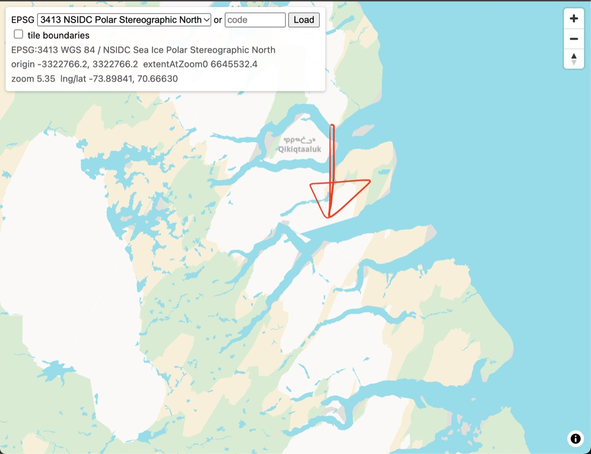 | 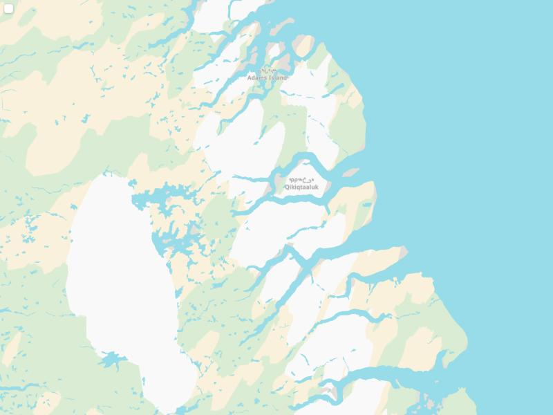 |

| EPSG:3978 at zoom 6.84, before                                          | after                                     |
| ----------------------------------------------------------------------- | ----------------------------------------- |
| 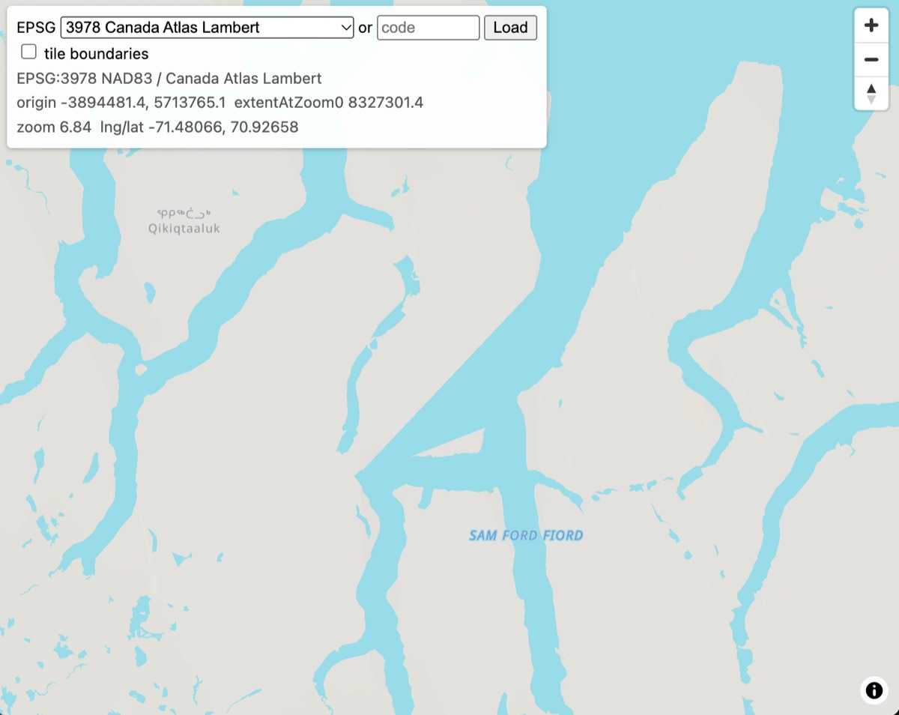 | 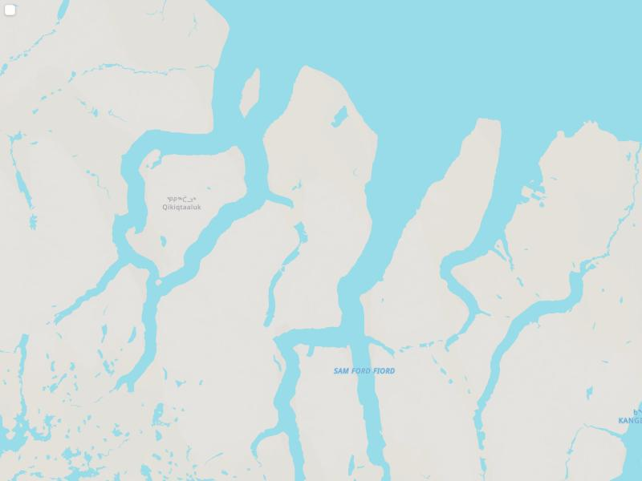 |

The "before" screenshots are from
[tilewarper](https://github.com/yutannihilation/tilewarper), the Cloudflare
Worker that serves this warp, as deployed on October 30, 2026, with the
triangle in EPSG:3413 outlined by hand; the "after" ones are the same places
after both fixes.

## 1. Zero-width bridges from clipping

### How a bridge is made

A source tile is pre-clipped to its own extent, and later to the part of it
an output tile can see ([step 3](vector-tiles.md#3-reading-and-preparing-a-source-tile)
and [step 2](vector-tiles.md#2-which-source-tiles-to-read)). The textbook
polygon clipper, Sutherland–Hodgman, clips a ring against one edge at a time
and always returns a single ring. When the clip edge cuts a polygon into
several pieces, the single ring keeps them connected by running along the
clip edge from one piece to the next and back again later: a _bridge_ of zero
width.

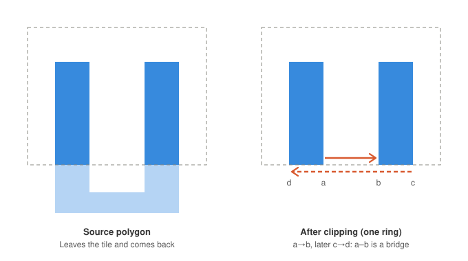

In the coordinates the clip ran in, the bridge is harmless. Its two passes
lie exactly on top of each other, enclose no area, and every renderer treats
the result as the two pieces it stands for. MVT allows it, and planetiler and
tippecanoe both emit such rings.

### Why it breaks after reprojection

Our pipeline then transforms the ring into the target CRS, densifies the
segments that bend ([step 5](vector-tiles.md#5-densification)) and rounds to
integers. Each pass of the bridge is a different sequence of vertices: the
first might be one long segment from `c` to `d`, the second two short ones
`a → b` and `b → c` with other vertices in between. Densification adds
points to the long segment where the short ones have none, and rounding
moves each vertex by up to half a unit on its own. On a curved projection the
two passes no longer coincide; they weave across each other, and the ring
intersects itself.

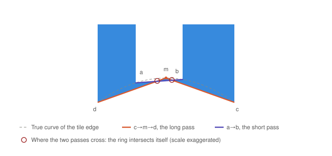

Earcut then triangulates a self-intersecting ring. What it produces depends
on the details, but typically one triangle spans from one piece to the other
across the gap that the bridge used to close, painting water over land.

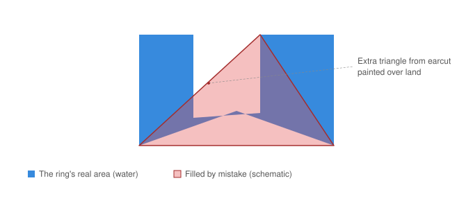

### The real case

In the EPSG:3978 screenshot above (zoom 6.84, output tile 6/36/24), the
water polygon's long straight edge along 70.613°N is the boundary between
source tiles 7/38/27 and 7/38/28. Clipping each source tile to its extent
left five bridges along that edge; after the transform, one of them crossed
itself and became the triangle's bottom edge. In the raw source tiles there
are no bridges at all. The EPSG:3413 case is the same construction one zoom
lower, between source tiles 6/19/13 and 6/19/14, where earcut over-filled the
ocean polygon by about 165,000 units², a tenth of the tile's width on a side
(measured with earcut 3.0.1; see [checking](#checking-for-the-problem) on
versions).

### The fix: `clipPolygon`

`src/mvt/clip.ts` has a second clipper, `clipPolygon`, for the clips that run
in source coordinates. It clips the exterior and the holes of a polygon
together against one half-plane at a time, keeps the pieces that fall inside
as open chains, and then sorts the chains' ends along the clip line and links
each exit to the next entry, which is the stretch of the clip line that runs
through the polygon's interior. The result is one ring per piece, with no
edge traversed twice, and holes are assigned to the exterior that contains
them. Both source-coordinate clips use it; the clip to the output tile
([step 6](vector-tiles.md#6-clip-quantize-winding)) keeps Sutherland–Hodgman,
because its bridges lie on axis-aligned lines in output units, where rounding
leaves both passes on the same integers.

With it, the source tiles for the six test tiles have 0 bridges instead of
1,066, and the triangles above are gone.

## 2. Rounding, touching rings and near-misses

### The problem that remained

After the bridge fix, one glacier in EPSG:3413 tile 5/11/25 still over-painted
by 7,166 units². Its rings did not cross in the source tile and did not cross
after the transform. They crossed after rounding.

The glacier's hole has a vertex lying exactly on the exterior's edge, a
_touch_. Topologically that is fine: the rings meet at a point and the
polygon is still simple. In the source tile the touch is stable, because
everything is already on the integer grid and nothing moves. In our output
the vertex and the edge's two endpoints are transformed and rounded
independently. A vertex that sits _on_ an edge has zero clearance from it,
so after rounding it can land on either side. Here it landed 0.4 units
outside, and the two hole edges meeting at it now cross the exterior.

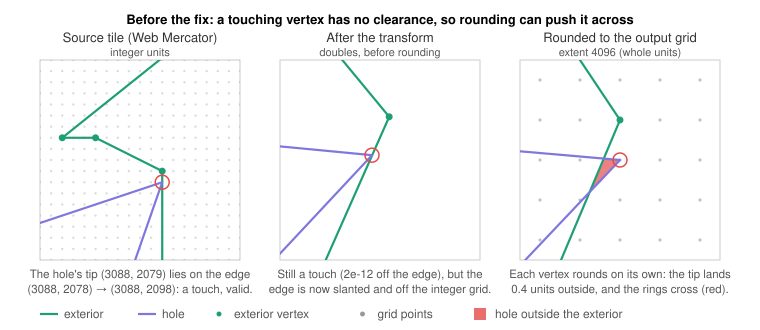

The crossed sliver is far smaller than one square unit, but earcut's
triangulation of the polygon changes globally:

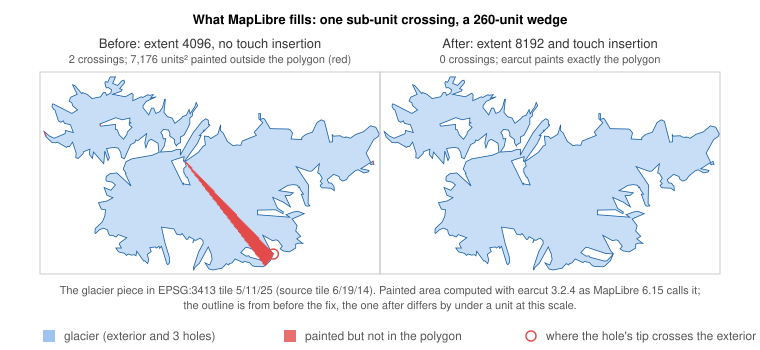

The same happens without any touch when two edges of a polygon pass within
about one unit of each other: a narrow neck, a hole close to its exterior.
Rounding moves each vertex by up to half a unit, so a clearance under one
unit can flip sign. Measured on 75 output tiles across five CRSs, 778 of
39,010 polygons gained a crossing from rounding alone, and 65 more already
crossed after the transform because a source touch had become a 10⁻¹²-unit
near-miss.

### Fix A: insert touch points

`insertTouches` in `src/mvt/clean.ts` runs when a source tile is prepared.
For every vertex of a polygon that lies strictly inside an edge of the same
polygon (its own ring or another), it inserts that vertex into the edge. The
touch becomes a shared vertex. The same source point always has the same
image and the same rounded position, so the two rings keep meeting at one
point instead of crossing. On integer source coordinates the test is exact;
edges that the pre-clip cut (one fractional end) are tested with a small
tolerance. Only collinear points are added, so no shape changes.

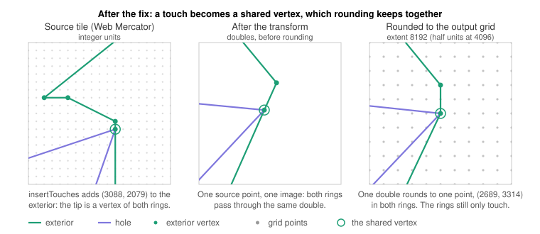

### Fix B: output extent 8192

MapLibre scales every tile to its internal 8192 grid and rounds there
(`EXTENT` in MapLibre's `src/data/extent.ts`). Tiles written at 4096 are scaled by
exactly 2, so half of that resolution went unused. Writing tiles at 8192
halves how far our rounding moves a vertex, and MapLibre's second rounding
becomes exact. A near-miss of a third of a unit, which whole-unit rounding
could flip, survives half-unit rounding:

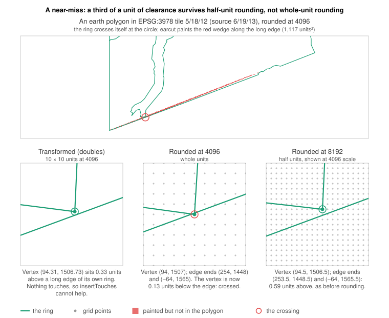

The buffer (128 units) and the densification tolerance (1 unit) are scaled
with it, so they cover the same ground as before. Tiles are about 3% larger.

### What the two fixes achieve

On the 75-tile sample, counting polygons whose earcut triangles cover more
than 200 units² (4096 scale) outside the polygon:

|        | Over-painted polygons | Total excess (units²) | Largest |
| ------ | --------------------- | --------------------- | ------- |
| Before | 38                    | 38,633                | 8,869   |
| A only | 32                    | 17,092                | 1,850   |
| B only | 16                    | 15,073                | 7,038   |
| A + B  | 7                     | 3,054                 | 777     |

A alone fixes the touches (including the glacier); B alone cannot, because a
touch has zero clearance on any grid. B removes most of the near-misses that
A cannot see. The 7 that remain are edges closer than half a unit before
rounding; the largest paints about 12 pixels on a 512-pixel tile. Removing
them would need either a repair pass after rounding (find the crossings and
cut the ring there) or snap rounding (round edges as well as vertices, as
GEOS and planetiler do). Both run on every polygon of every output tile, and
neither is implemented.

## Checking for the problem

The test that found both problems is to triangulate each output polygon the
way MapLibre does and compare the triangles' area with the polygon's true
area:

1. Decode the tile with `@mapbox/vector-tile`, group rings into polygons with
   its `classifyRings`, and keep the closing point of each ring.
2. Scale to 8192 and round, as `loadGeometry` does.
3. Run `earcut` (the version MapLibre resolves; 3.2.4 for MapLibre 6.15) on
   the flattened rings with the hole indices.
4. Sum the triangles' areas and subtract the polygon's signed area. The
   difference is what is painted outside the polygon.

A polygon that looks right in a point-in-polygon test (`queryRenderedFeatures`
says land) can still fail this check, because hit-testing uses the ring
geometry and the fill uses the triangles. Earcut's version matters: 3.0.x and
3.2.x triangulate degenerate rings differently, and open rings give different
results from closed ones.
