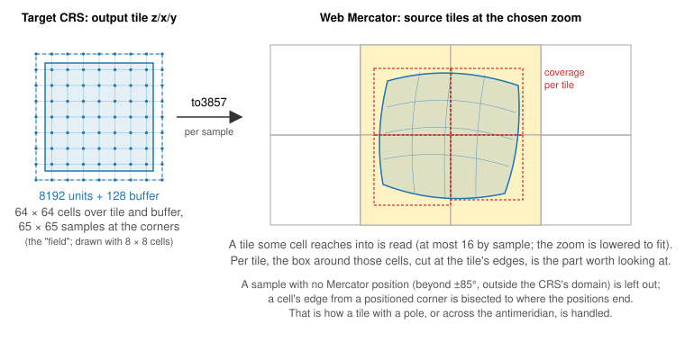
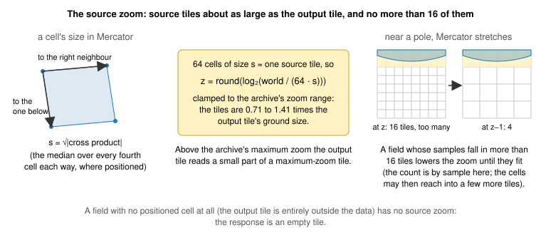
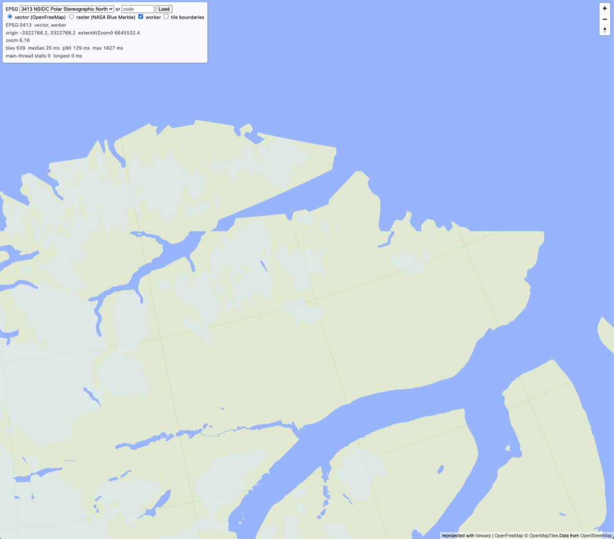
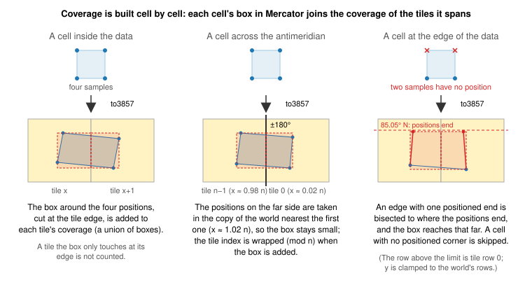
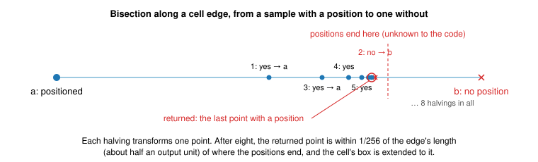

# Choosing the source tiles

The second step of [serving a vector tile](vector-tiles.md): from the output
tile `z/x/y` in the target CRS to the Web Mercator tiles to read, and to the
part of each worth looking at. The raster path (`.png`) shares the field and
the zoom choice, but not the coverage.

The output tile's shape in Mercator is curved, may contain a pole, may
straddle the antimeridian, and may reach outside the CRS's domain, so its
four corners are not enough to find the tiles under it. Everything below is
built on a grid of samples instead.

## The field

A grid of 64 × 64 _cells_ is laid over the output tile and its 128-unit
buffer, and the cells' corners, 65 × 65 samples 132 output units apart, are
projected to Mercator (`mercatorField`, with `to3857`). Every sample is
projected back and accepted only if it returns to where it started, so a
sample has no Mercator position where the CRS has no such point, or beyond
the Mercator latitude limit of ±85.05°. The field is coarse on purpose: it
only picks the source zoom and bounds the coverage, and a tile with a pole or
the antimeridian in it computes every sample exactly, at two proj4 calls
each. (The reprojected TileJSON's maximum zoom is measured by `vectorMaxZoom`
with a finer field of 256 samples per side, so that its rounding does not
depend on this choice.)

## The source zoom

The source zoom is the one whose tiles have about the same ground size as the
output tile. A cell's size in Mercator meters is the square root of the
absolute cross product of the vectors to its right and lower neighbours
(the median over every fourth cell each way, where those three samples have
a position), and 64 such cells make one source tile:

> z = round(log₂(world / (64 · s)))

clamped to the source's zoom range (the TileJSON's `minzoom` and
`maxzoom`), so the source tiles are 0.71 to 1.41
times the output tile's ground size. Above the source's maximum zoom the
output tile reads a small part of a maximum-zoom tile (overzoom).

The zoom is then lowered until the tiles the samples fall in number at most
16, which matters at high latitudes, where Mercator stretches the output
tile over many source tiles. The count is by sample; the cells between
samples can reach into a few more tiles, and those are read too. A field with no positioned cell among those measured (the
output tile is entirely outside the data) has no source zoom, and the
output tile is empty.

### Where the zoom changes

The choice is made per output tile, so two neighbouring output tiles at the
same zoom can read different source zooms. Where the scale between the CRS
and Mercator changes across the map, the unrounded zoom changes with it, and
the tiles on either side of the place where it passes x.5 round to different
zooms. In a polar stereographic CRS that place is a parallel: Mercator
stretches more towards the pole, so the unrounded zoom falls steadily. Each
output zoom adds exactly 1 to it, so the change stays at about the same
latitude at every zoom, drawn along the edges of the output tiles there.

A source generalized per zoom (OpenMapTiles simplifies coastlines and ice
differently at each) then shows two versions of the data side by side. Below,
EPSG:3413 over northern Greenland (82.6°N, 24.6°W) at map zoom 6.16: the
output tiles above the horizontal break read source zoom 5 and those below
read zoom 6, the unrounded zoom passing 5.5 between them.

Rounding differently (down, or up) moves the break to another latitude; it
does not remove it. The 16-tile limit is not involved here: these output
tiles need at most 8 source tiles.

The thin green lines in the same picture are a different effect: the outline
of a park polygon drawn along source tile boundaries, the first of the
[known limitations](vector-tiles.md#known-limitations). They are wider apart
above the break, where the source tiles are twice the size.

## Coverage, cell by cell

A source tile is big, and most of it is often outside the output tile. The
_coverage_ of a source tile is the part of it the output tile can see: the
union of the boxes of the cells that reach into it, in fractions of the tile
(`sourceCoverage`). Only features whose bounding box meets the coverage are
transformed, and each of those is clipped to it first, so that the proj4 work
is spent on what can appear in the output.

Each cell is visited once. Its positioned corners are converted to global
tile units at the source zoom, with two adjustments:

- x is taken in the copy of the world nearest the positions already
  included, so a cell across the antimeridian gets a small box spanning the
  last and the first column, and the tile index is wrapped (mod n) when the
  box is added.
- y is clamped to the world's rows, so a box that would reach beyond the
  latitude limit stops at tile row 0 or n − 1.

The box around the positions is cut at the tile edges, and each piece joins
that tile's coverage. A tile the box only touches at its edge is not counted.

### Where the positions end

A cell with corners on both sides of the data's edge (the latitude limit, a
world projection's limb) would get a box that stops at its last positioned
corner, up to a whole cell short of the edge, and the strip of data in
between would be missed. So for each cell edge with one positioned end and
one without, the edge is bisected to where the positions end (`reach`), and
the box is extended to the last point found with a position.

Each halving transforms one point, eight in all, so the point found is within
1/256 of the edge's length, about half an output unit, of the true edge. A
cell with no positioned corner is skipped: data in it is not seen, which is
the thin-strip limitation listed on the main page.

## What comes out

For each source tile at the chosen zoom: its coordinates, and a coverage box
in fractions of the tile. The tiles are read in parallel and prepared (step 3
on the main page); then each feature whose bounding box meets the coverage is
clipped to it and goes through [the transform](vector-transform.md).
