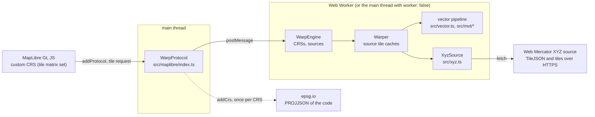
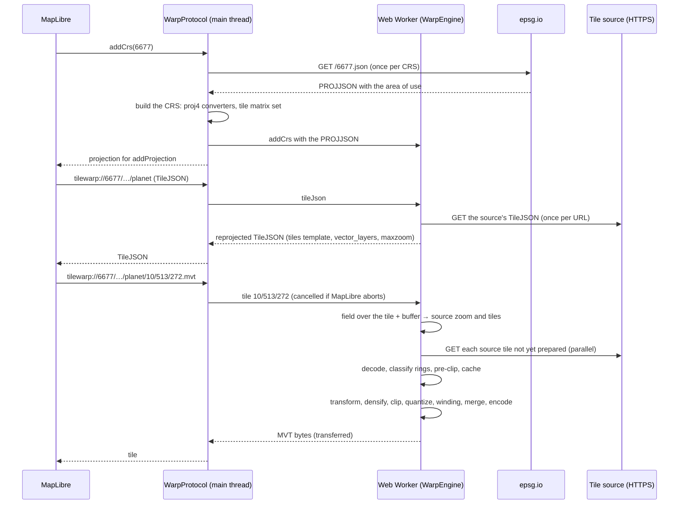
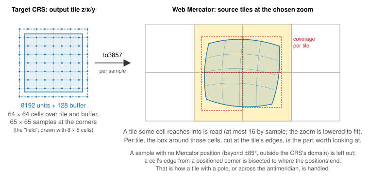
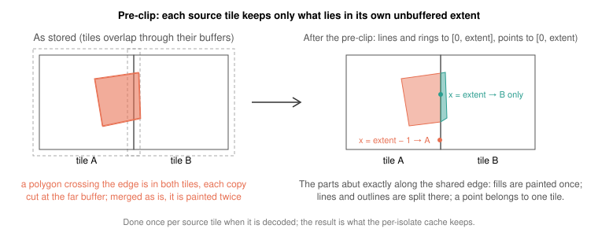
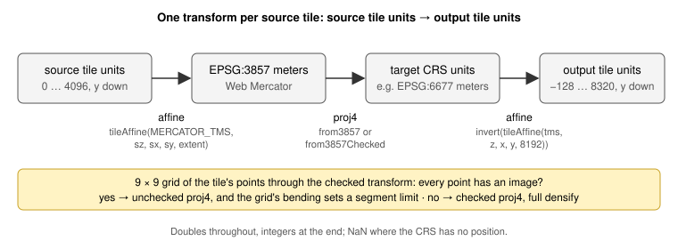
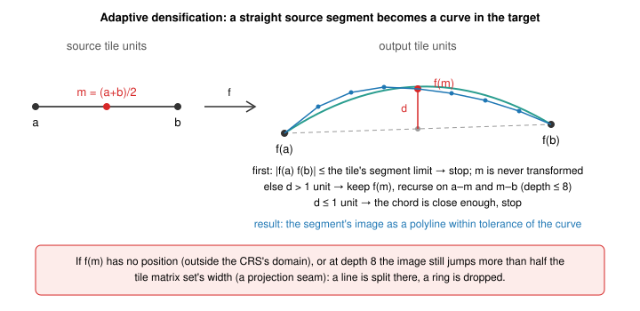
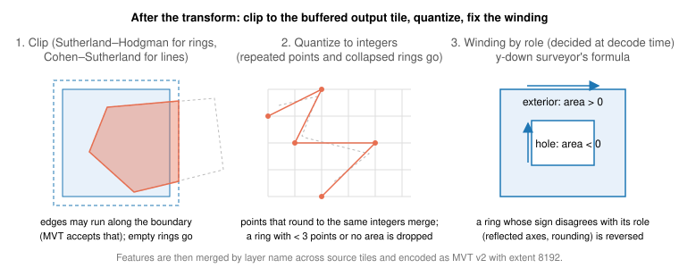
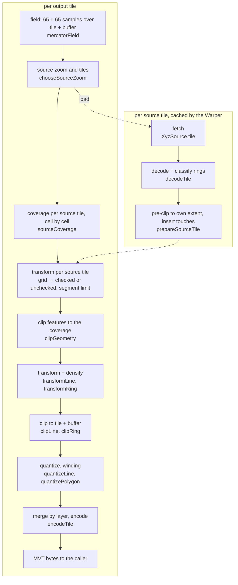

# How a vector tile is served

This page follows one tile request from MapLibre to the bytes it gets back:
`tilewarp://6677/https://tiles.openfreemap.org/planet/{z}/{x}/{y}.mvt`, an
output tile in EPSG:6677 from a Web Mercator source named by its TileJSON.
Two steps have pages of their own with the figures that explain them:
[choosing the source tiles](vector-source-selection.md) and [transforming a
source tile](vector-transform.md). The raster path (`.png`) shares the first
half, up to the choice of source tiles, and is not described here.

## The parts

- The client is MapLibre with a CRS registered through `addProjection`,
  from what `WarpProtocol.addCrs` returns. Its source is a
  `tilewarp://{epsg}/{TileJSON URL}` URL; the protocol answers it with the
  reprojected TileJSON, whose `tiles` template points back at the protocol
  with `.mvt` for a vector source (one with `vector_layers`) or `.png` for a
  raster one.
- The protocol runs on the main thread, where it parses URLs and, in
  `addCrs`, fetches the PROJJSON and builds the CRS once. Every call
  (`addCrs` with that PROJJSON, the TileJSON, a tile) is posted to a Web Worker it creates on
  first use, and the answer is transferred back. With `worker: false` the
  same engine runs on the main thread instead.
- The engine (`WarpEngine`) keeps the CRSs added, one `XyzSource` per
  TileJSON URL, and one `Warper`, which caches the source tiles it has
  decoded and prepared. Nothing is kept between page loads; a tile MapLibre
  asks for twice is warped twice, from cached source tiles.
- The source is any Web Mercator XYZ server with a TileJSON: `XyzSource`
  fills its tile URL template and fetches each tile over HTTPS, so the server
  must allow cross-origin requests.

The same pipeline runs outside the browser through the core API: a
`Warper` with any `MercatorSource` (`XyzSource`, or your own, such as a
reader for a PMTiles archive) and a `Crs` from `resolveCrs`.

## One request, start to end

The steps below are the warp's own work, in order.

### 1. The CRS and the output tile's frame

The CRS is an EPSG code. Its PROJJSON, from epsg.io unless `addCrs` is given
one, gives proj4 the definition and gives the warp the area of use
(epsg.io's `bbox`), from which the tile matrix set is derived
(`tmsFromAreaOfUse`): the smallest square around the projected area of use,
with tile 0/0/0 as that square. The protocol returns the same square to
`addProjection`, so MapLibre and the warp agree on where tile `z/x/y` is.
A geocentric CRS (one with no plane to tile) or a PROJJSON without an area
of use is rejected with `CrsError`.

From the tile matrix set, `tileAffine` gives the affine from output tile
units (0 to 8192, y down) to CRS coordinates. Its inverse is the last step of
every coordinate's journey.

### 2. Which source tiles to read

The warp needs the Web Mercator tiles under the output tile. The output
tile's shape in Mercator is curved, may contain a pole, may straddle the
antimeridian, and may reach outside the CRS's domain, so the four corners are
not enough. Instead, a grid of 64 × 64 cells is laid over the output tile and
its 128-unit buffer, and the cells' corners, 65 × 65 samples, are projected
to Mercator (`mercatorField`, shared with the raster path). Samples with no
Mercator position are left out: beyond ±85° of latitude, or where the CRS
has no such point.

From the field come, in order:

- **The source zoom**: the one whose tiles have about the same ground size
  as the output tile (0.71 to 1.41 times), from the median cell size in
  Mercator meters, clamped to the source's zoom range (the TileJSON's
  `minzoom` and `maxzoom`) and lowered until at most 16 tiles are needed.
  Above the source's maximum zoom the output tile reads a small part of a
  maximum-zoom tile (overzoom).
- **The tiles to read**: those some cell reaches into.
- **A coverage per tile**: the box around the cells that reach into it, in
  fractions of the tile. Only features whose bounding box meets it are
  transformed, and each of those is clipped to it first. Where a cell's
  corner has no position (past the latitude limit, outside a world
  projection's limb), the cell's edges from its positioned corners are
  bisected to where the positions end, so the box reaches the data's edge.

[Choosing the source tiles](vector-source-selection.md) shows each of these
with a figure.

### 3. Reading and preparing a source tile

Source tiles are read in parallel through the source's `tile(z, x, y)`. For
`XyzSource` that is one HTTPS request each; 404, 204 and an empty body mean
no tile there, and gzipped bytes are gunzipped even without
`Content-Encoding`. A missing tile is an empty one; any other HTTP error or
a failed request (network, CORS) fails the output tile with `UpstreamError`,
and bytes that do not gunzip with `SourceError`.

A prepared source tile is target-independent, so the `Warper` keeps it in a
cache bounded by its estimated size (32 MB in the protocol's engine), where
the neighbouring output tiles that read the same source tiles find it.
Reads under way are shared too, so concurrent output tiles do not fetch a
source tile twice, and a read MapLibre aborts still finishes and is kept.
Preparing means:

- **Decode** the MVT with `@mapbox/vector-tile`: layers, features, ids,
  properties, integer geometry in the tile's extent (4096 for OpenMapTiles
  and Protomaps tiles).
- **Classify rings** of polygons into exteriors and holes right away, by
  winding, with the same rule MapLibre uses. The source is Web Mercator, so
  its winding is trustworthy; after reprojection it may not be. The role is
  carried with each ring from here on.
- **Pre-clip** every feature to the tile's own unbuffered extent, so that
  what neighbouring source tiles contribute abuts instead of overlapping.
- **Insert touches**: a vertex of a polygon lying on one of its edges is
  added to that edge, so that rounding cannot pull them apart (below).

Polygons are pre-clipped (and clipped to the coverage) with `clipPolygon`,
not Sutherland–Hodgman. A polygon that the edge cuts into several pieces
comes out as several polygons. Sutherland–Hodgman would keep one ring and
join the pieces with zero-width bridges running along the edge and back.
Such a bridge is harmless where it is drawn, but the transform maps its two
passes through different vertices (each is densified and rounded on its
own), so on a curved projection they cross. The ring then intersects itself,
and MapLibre's triangulation (earcut) fills large triangles that are not in
the polygon.

Wherever a vertex of a polygon lies exactly on one of the polygon's edges
(a hole touching its exterior, say), it is added to that edge
(`insertTouches`). A vertex on an edge has no clearance from it: after the
transform and rounding it can land on either side, and the rings cross. The
same point as a vertex of both rings always lands in one place. In the
source's integer coordinates the test is exact.

[Why a valid polygon can come out with a stray triangle](polygon-pitfalls.md)
shows both problems on real tiles, with figures, and what they looked like on
the map.

#### Joining the pieces again (`merge`)

The pre-clip leaves a polygon that spans several source tiles as one piece
per tile, each with an edge along the boundary where the polygon goes on in
the neighbour. Fills do not show it, but a fill layer with an outline color
of its own draws those edges, a grid over a large polygon. A source with
`merge` set (`tilewarp://{epsg}/merge/…` for the protocol) joins the pieces
again before the transform (`mergeAcrossTiles`, `mergePieces`). It is off by
default.

- **Which pieces.** Polygon features of the same layer, feature id and
  properties, found in two or more of the source tiles the output tile
  reads. Features without an id, lines and points are left as they are.
- **One frame.** The pieces are put in one tile's units, continued over the
  other tiles (across the antimeridian too), and clipped to one rectangle,
  the bounds of everything the output tile sees. Clipped each to its own
  tile's coverage, two pieces could end at different places along the
  boundary they share. Where the tiles read go all the way around the
  world, the frame starts at the antimeridian, and a polygon is not joined
  across it.
- **Dropping the cuts.** An edge lying on the boundary between two tiles
  that were both read is dropped. What is left of each ring is chains that
  start and end on a boundary.
- **Joining.** The end of each chain is joined to the start of the one chain
  from another tile that begins within 2 units (of 4096) of it. The two
  tiles cut the same edge of the polygon, but each from its own rounded
  copy, so the two points differ a little (by up to 1.5 units in
  OpenFreeMap's tiles); the end's point is kept.
- **Or not at all.** If an end has no such start, or several, the feature
  is left in pieces, as without `merge`. That happens where the neighbouring
  tile has the polygon under another id or not at all (in OpenFreeMap's
  zoom 4 tiles the Northeast Greenland National Park has one id in one tile
  and another next door), where an edge of the polygon itself runs along a
  tile boundary, and where a part is thinner than the tolerance. A feature
  is also left in pieces when, once joined and clipped to what the output
  tile sees of its pieces' tiles, one of its rings has a vertex outside the
  CRS's domain: such a ring is dropped whole, which in pieces costs only the
  pieces at the domain's edge.
- **How exact.** A join moves a point by up to the tolerance. Where a part
  of a polygon is no wider than that at a boundary, its shape can change by
  as much (a quarter of a pixel at most).

The joined polygon comes out as one feature, where the first of its pieces
would have been, and is in several source tiles, so it does not take one
tile's shortcuts below: it is transformed with the frame's checked
transform and full densification. In the 37 tiles measured the transform
took about 1 to 3 times as long (median 1.6): most in tiles that hold
little besides large polygons, hardly more in dense ones, and about 30%
more in total.

### 4. The transform

Each source tile gets one transform from its own units to output tile units:
an affine into Mercator meters, proj4 from Mercator into the CRS, and the
inverse of the output tile's affine. Doubles are used throughout; coordinates
become integers only at the end.

proj4 transforms points, and for a point outside a projection's domain it may
answer with a finite position somewhere else (transverse Mercator far from
its meridian, say). The _checked_ variant projects the answer back and
accepts it only if it returns to the input; otherwise the point has no image.
That doubles the proj4 work, so before transforming a tile, a 9 × 9 grid of
its points is tried with the checked transform. If every grid point has an
image, the tile lies inside the domain and is transformed unchecked. The grid
also measures how much the transform bends, which gives the longest segment
the tile bends by no more than one output unit: its _segment limit_.

### 5. Densification

A straight segment in the source is a curve in the target. A segment whose
image is no longer than the tile's segment limit is kept as it is. Any other
is subdivided adaptively in source coordinates: the midpoint is transformed
and compared with the midpoint of the transformed endpoints; if they differ
by more than one output unit, the midpoint is kept and both halves are tried
again, to a depth of eight.

Where a vertex or a midpoint has no image, or where at the recursion limit a
tiny piece still jumps across half the tile matrix set (a projection seam),
a line is split and a ring is dropped.

[Transforming a source tile](vector-transform.md) shows the grid test, the
segment limit and the densification with figures.

### 6. Clip, quantize, winding

The transformed geometry is clipped to the output tile plus its buffer, an
axis-aligned rectangle in output units: Cohen–Sutherland for lines (a line
that leaves and comes back becomes several), Sutherland–Hodgman for rings
(edges may run along the rectangle, which MVT accepts; here the bridges are
already in output units, on lines that rounding leaves straight, so their two
passes stay on top of each other). Coordinates are then
rounded to integers, repeated points removed, lines with fewer than two
points and rings with fewer than three or no area dropped, and a polygon
whose exterior is gone takes its holes with it.

Finally the winding: by the MVT spec's surveyor's formula in y-down
coordinates, an exterior ring has positive area and a hole negative. Any ring
whose sign does not match the role recorded at decode time is reversed.
Reflected axes, singularities and rounding are the usual causes.

### 7. Encode and answer

Features are merged by layer name across the source tiles, each layer's
key and value tables are rebuilt, and the tile is written as MVT version 2
with extent 8192 by a small encoder on `pbf`. That is MapLibre's internal
grid, so the client uses the coordinates as they are, and twice the source's
4096, so rounding moves vertices half as far as at 4096. Ids and properties
pass through unchanged. The bytes are returned uncompressed: the worker
transfers them to the protocol, which hands them to MapLibre. An output tile
with nothing in it is an empty MVT, not an error. (A server built on the
core API compresses the bytes itself; `compress` and `compressStream` are
there for it.)

## The pipeline at a glance

| Where                                         | What                                                                           |
| --------------------------------------------- | ------------------------------------------------------------------------------ |
| `src/maplibre/index.ts`                       | the protocol: URLs, `addCrs`, the worker and its calls                         |
| `src/maplibre/engine.ts`, `worker.ts`         | the engine the calls run on: CRSs, sources, the `Warper`; the worker around it |
| `src/xyz.ts`                                  | an HTTPS XYZ source from a TileJSON                                            |
| `src/warper.ts`                               | source tile caches, the raster render                                          |
| `src/decode.ts`                               | raster source tiles: 8-bit PNG in JS, the rest with the browser                |
| `src/crs.ts`                                  | CRS from PROJJSON, checked projections                                         |
| `src/tms.ts`                                  | tile matrix set and tile affines                                               |
| `src/warp.ts`                                 | the field and the source zoom choice (shared with raster)                      |
| `src/vector.ts`                               | the pipeline: coverage, transform choice, reproject, merge                     |
| `src/mvt/decode.ts`, `encode.ts`              | MVT in and out                                                                 |
| `src/mvt/clip.ts`, `transform.ts`, `clean.ts` | clipping, densification, touches, quantization and winding                     |
| `src/mvt/merge.ts`                            | joining a polygon's pieces across source tiles (`merge`)                       |

## Known limitations

- Lines and polygon outlines are split at source tile boundaries. Fills are
  not affected, but strokes, dashes and line labels are, and a fill layer
  with an outline color of its own draws a thin line along each boundary
  that crosses a polygon. For polygons with feature ids,
  [`merge`](#joining-the-pieces-again-merge) joins the pieces again, where
  the ids agree across tiles; lines stay split.
- A ring with any vertex outside the CRS's domain is dropped whole.
- Edges of a polygon that come within about one output unit of each other
  without touching (a narrow neck, a hole close to its exterior) can cross
  after rounding to integers, and MapLibre may then fill a small wrong
  triangle there ([details](polygon-pitfalls.md#2-rounding-touching-rings-and-near-misses)).
- A projection whose seam falls inside a source tile (an Equal Earth not
  centered on Greenwich) splits lines and drops rings there.
- An output tile whose data is a strip thinner than a field cell (about 130
  units, 4 px) at the latitude limit or a world projection's limb, with no
  field sample in it, is served empty.
- CPU time is dominated by proj4. A dense tile takes tens of milliseconds,
  which is why the protocol warps in a Web Worker by default; the README
  has measurements.
