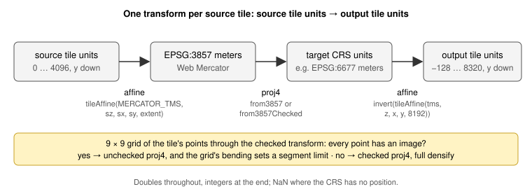
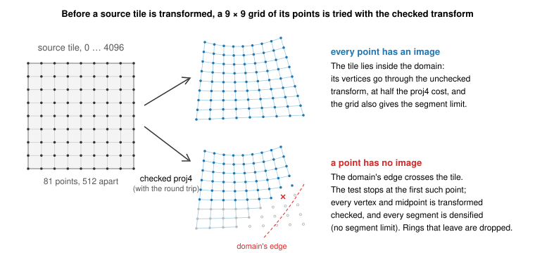
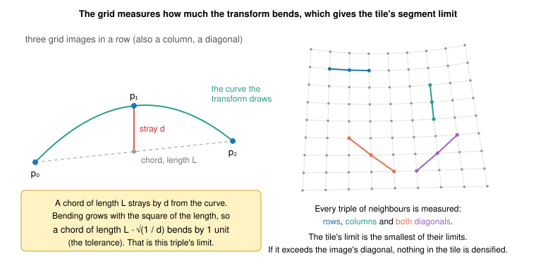
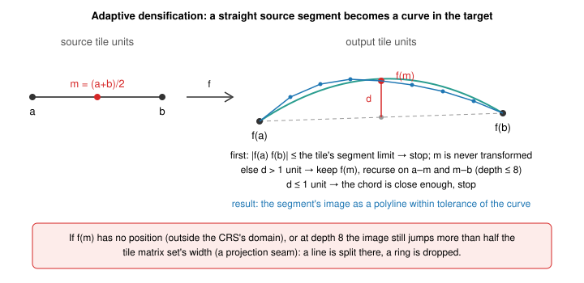

# Transforming a source tile

Steps 4 and 5 of [serving a vector tile](vector-tiles.md): how one source
tile's integer coordinates become output tile coordinates, how the pipeline
decides how much checking and densifying that tile needs, and how a straight
segment becomes a curve.

## The chain

Each source tile gets one transform from its own units to output tile units:
an affine into Mercator meters, proj4 from Mercator into the CRS, and the
inverse of the output tile's affine. Doubles are used throughout; coordinates
become integers only at the end.

proj4 transforms points, and for a point outside a projection's domain it may
answer with a finite position somewhere else (transverse Mercator far from
its meridian, say). The _checked_ variant projects the answer back and
accepts it only if it returns to the input; otherwise the point has no image.
That doubles the proj4 work, and most tiles do not need it.

## The grid test

Before a tile is transformed, a 9 × 9 grid of its points, 512 source units
apart, is tried with the checked transform (`gridImages`).

- If every grid point has an image, the tile lies inside the domain, and its
  vertices go through the unchecked transform, at half the proj4 cost. The
  grid is then also used to measure the bending, below.
- If a grid point has no image, the domain's edge crosses the tile. The test
  stops at that point; every vertex and every midpoint is transformed
  checked, and every segment is densified with no segment limit (the depth
  limit of eight still holds), so that a segment leaving the domain between
  its ends is found and split, or its ring dropped.

The test costs at most 81 checked transforms per tile (and per layer extent,
normally one), against thousands of vertices in a dense tile.

## The segment limit

Densification (below) exists because a straight segment in the source is a
curve in the target. How curved depends on the projection and on where the
tile is, and the grid already tells: each interior grid point strays from the
chord between its two neighbours by some distance d, over a chord of length
L. Bending grows with the square of a chord's length, so a chord of length
L · √(1 / d) bends by one output unit, which is the tolerance. The smallest
such length over all triples in rows, columns and both diagonals is the
tile's _segment limit_ (`straightChord`): a segment whose image is shorter
than it cannot bend by more than the tolerance, and is kept straight without
transforming its midpoint.

The diagonals matter: a 5 × 5 grid measuring rows and columns alone let
segments at a zoom 0 tile's polar corner bend by 26 units, where a world
projection's scale changes fastest; 9 × 9 with diagonals bounds them at 6.
When the limit exceeds the tile image's diagonal, nothing in the tile needs
densifying and no midpoint is ever transformed.

## Densification

A straight segment in the source is a curve in the target. Every segment is
subdivided adaptively in source coordinates (`densify`):

1. If the image of the segment, from f(a) to f(b), is no longer than the
   tile's segment limit, stop. The midpoint is never transformed.
2. Otherwise transform the midpoint m and compare f(m) with the midpoint of
   f(a) and f(b). If they differ by more than one output unit, keep f(m) and
   try both halves again, to a depth of eight.
3. If they differ by no more than one unit, the chord is close enough: stop.

Where a vertex or a midpoint has no image, or where at the recursion limit a
tiny piece still jumps across half the tile matrix set's width (a projection
seam), the segment is marked: a line is split there, and a ring is dropped.

## What comes out

Geometry in output tile units, as doubles, with every curve followed to
within one unit. It is then clipped to the output tile and its buffer,
rounded to integers and checked for winding (step 6 on the main page).
